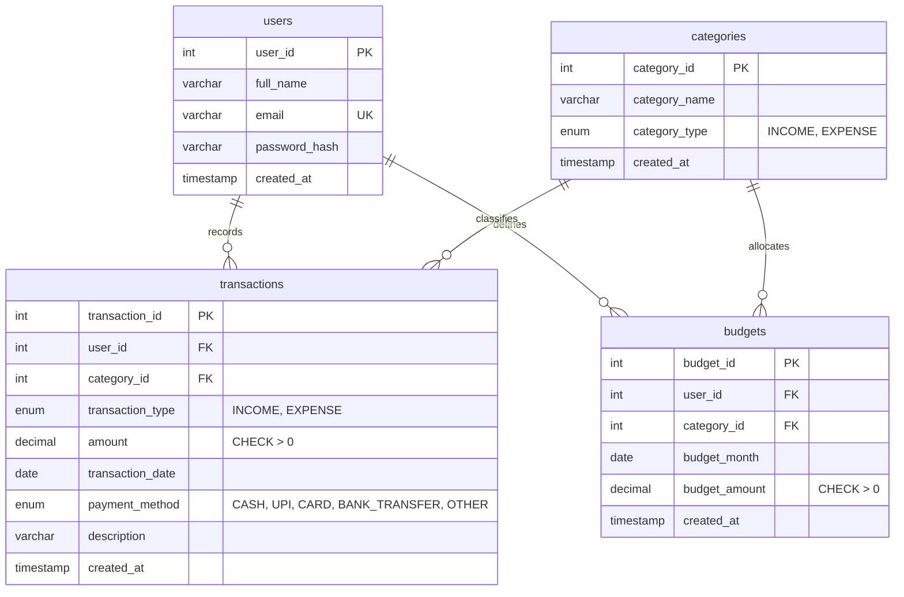

# Expense Tracker and Budget Management System
### B.Tech Computer Science and Engineering — DBMS Mini-Project

A full-stack, professional, SaaS-style personal finance and budget management dashboard engineered to demonstrate core **Relational Database Management System (RDBMS)** concepts using **MySQL 8.0+**, **Node.js/Express.js**, and **React (Vite) + Tailwind CSS**.

---

## 1. Project Overview & DBMS Concepts Demonstrated

This system provides complete personal financial tracking with income and expense categorization, monthly budget limits with live utilization tracking, statistical analytics, and a dedicated **Database Views Laboratory** developed specifically for academic DBMS practical evaluations.

### Key DBMS Concepts Implemented:
1. **Relational Schema Design & Constraints**:
   - Primary Keys (`AUTO_INCREMENT PRIMARY KEY`)
   - Foreign Keys with referential integrity actions:
     - `ON DELETE CASCADE ON UPDATE CASCADE` (e.g., user deletion cascades to transactions and budgets)
     - `ON DELETE RESTRICT ON UPDATE CASCADE` (e.g., prevents deletion of categories referenced by transactions/budgets)
   - Domain constraints: `CHECK (amount > 0)`, `CHECK (budget_amount > 0)`, `CHECK (email LIKE '%_@__%.__%')`
   - Composite Unique Keys: `UNIQUE(category_name, category_type)` and `UNIQUE(user_id, category_id, budget_month)`
2. **Indexing & Performance Optimization**:
   - Single & composite B-Tree indexes on `(user_id)`, `(category_id)`, `(transaction_date)`, `(user_id, transaction_date)`, and `(user_id, budget_month)`.
3. **Advanced SQL Joins & Subqueries**:
   - `INNER JOIN`, `LEFT JOIN`, and correlated subqueries for real-time budget spending evaluation.
4. **Aggregate Functions & Grouping**:
   - `SUM()`, `COUNT()`, `AVG()`, `MIN()`, `MAX()`, `GROUP BY`, and `HAVING` with conditional SQL `CASE` statements.
5. **Database Views Module (Core Practical Focus)**:
   - **`v_expense_transactions`**: Simple, single-table horizontal slice view created **`WITH CHECK OPTION`**. Genuinely updatable (`SELECT`, `INSERT`, `UPDATE`, `DELETE`).
   - **`v_transaction_details`**: Multi-table joined view denormalizing transactions with user and category names.
   - **`v_monthly_expense_summary`**: Aggregate view computing monthly income, expenses, and net savings using `GROUP BY`.
   - **`v_budget_utilization`**: Complex analytical view comparing planned budgets against real actual spending.
   - **Enforcement of `WITH CHECK OPTION`**: Demonstrates MySQL rejecting mutations that violate view criteria (Error 1369).
   - **Safe DDL Demonstration (`DROP VIEW`)**: Controlled drop view and immediate safe re-creation.

---

## 2. Technology Stack

- **Frontend**:
  - React 18 (Vite)
  - JavaScript (ES6+)
  - Tailwind CSS (SaaS fintech design with light background and navy sidebar)
  - React Router DOM v6
  - Axios (with JWT interceptors)
  - Recharts (Area, Bar, Line, Pie/Donut charts)
  - Lucide React (Fintech and database iconography)
  - React Hook Form (Client-side validation)
- **Backend**:
  - Node.js & Express.js (REST API architecture)
  - MySQL 8.0+
  - `mysql2/promise` (Connection pool with parameterized queries)
  - `bcryptjs` (Salted password hashing)
  - `jsonwebtoken` (JWT stateless authentication)
  - `express-validator` (Input sanitation & validation)
  - `helmet` & `cors` (API security)
- **Database**:
  - MySQL Server 8.0.46
  - InnoDB Storage Engine

---

## 3. Entity-Relationship (ER) Diagram



---

## 4. Database Schema and Views Architecture

### Tables
| Table | Description | Primary Key | Foreign Keys / Constraints |
|---|---|---|---|
| `users` | User credentials & profile | `user_id` | Unique `email`, CHECK email format |
| `categories` | Financial taxonomies | `category_id` | Unique `(category_name, category_type)` |
| `transactions` | Income & expense ledger | `transaction_id` | FK `user_id` (CASCADE), FK `category_id` (RESTRICT), `amount > 0` |
| `budgets` | Monthly category limits | `budget_id` | FK `user_id` (CASCADE), FK `category_id` (RESTRICT), Unique `(user_id, category_id, budget_month)` |

### Database Views
1. **`v_expense_transactions`** (Updatable with `WITH CHECK OPTION`):
   ```sql
   CREATE OR REPLACE VIEW v_expense_transactions AS
   SELECT transaction_id, user_id, category_id, transaction_type, amount,
          transaction_date, payment_method, description, created_at
   FROM transactions
   WHERE transaction_type = 'EXPENSE'
   WITH CHECK OPTION;
   ```
2. **`v_transaction_details`** (Joined View):
   ```sql
   CREATE OR REPLACE VIEW v_transaction_details AS
   SELECT t.transaction_id, t.user_id, u.full_name AS user_name, u.email AS user_email,
          t.category_id, c.category_name, c.category_type, t.transaction_type,
          t.amount, t.transaction_date, t.payment_method, t.description, t.created_at
   FROM transactions t
   JOIN users u ON t.user_id = u.user_id
   JOIN categories c ON t.category_id = c.category_id;
   ```
3. **`v_monthly_expense_summary`** (Aggregate View):
   ```sql
   CREATE OR REPLACE VIEW v_monthly_expense_summary AS
   SELECT t.user_id,
          DATE_FORMAT(t.transaction_date, '%Y-%m-01') AS month_date,
          DATE_FORMAT(t.transaction_date, '%Y-%m') AS formatted_month,
          COALESCE(SUM(CASE WHEN t.transaction_type = 'INCOME' THEN t.amount ELSE 0 END), 0) AS total_income,
          COALESCE(SUM(CASE WHEN t.transaction_type = 'EXPENSE' THEN t.amount ELSE 0 END), 0) AS total_expenses,
          COALESCE(SUM(CASE WHEN t.transaction_type = 'INCOME' THEN t.amount ELSE -t.amount END), 0) AS net_savings,
          COUNT(t.transaction_id) AS total_transactions
   FROM transactions t
   GROUP BY t.user_id, DATE_FORMAT(t.transaction_date, '%Y-%m-01'), DATE_FORMAT(t.transaction_date, '%Y-%m');
   ```
4. **`v_budget_utilization`** (Complex Analytical View):
   ```sql
   CREATE OR REPLACE VIEW v_budget_utilization AS
   SELECT b.budget_id, b.user_id, b.category_id, c.category_name, b.budget_month,
          DATE_FORMAT(b.budget_month, '%Y-%m') AS formatted_month, b.budget_amount,
          COALESCE(SUM(t.amount), 0) AS amount_spent,
          (b.budget_amount - COALESCE(SUM(t.amount), 0)) AS remaining_budget,
          ROUND((COALESCE(SUM(t.amount), 0) / b.budget_amount) * 100, 2) AS percentage_used,
          CASE 
              WHEN COALESCE(SUM(t.amount), 0) > b.budget_amount THEN 'Exceeded'
              WHEN COALESCE(SUM(t.amount), 0) >= (b.budget_amount * 0.85) THEN 'Near Limit'
              ELSE 'On Track'
          END AS budget_status
   FROM budgets b
   JOIN categories c ON b.category_id = c.category_id
   LEFT JOIN transactions t ON t.user_id = b.user_id 
       AND t.category_id = b.category_id 
       AND t.transaction_type = 'EXPENSE'
       AND DATE_FORMAT(t.transaction_date, '%Y-%m') = DATE_FORMAT(b.budget_month, '%Y-%m')
   GROUP BY b.budget_id, b.user_id, b.category_id, c.category_name, b.budget_month, b.budget_amount;
   ```

---

## 5. Pre-seeded Demo Evaluator Accounts

For convenient academic assessment, fictional records are pre-seeded in MySQL:

| Account Name | Email Address | Password | Profile Data Included |
|---|---|---|---|
| **Rahul Sharma** | `rahul.sharma@example.com` | `Password123!` | 22 Transactions (Income, Expenses, UPI/Card), 9 Budgets |
| **Priya Patel** | `priya.patel@example.com` | `Password123!` | 4 Transactions, 3 Budgets |

*Note: The login page includes 1-click demo credential autofill buttons.*

---

## 6. Installation & Setup Guide

### Prerequisites
- Node.js (v18.0+)
- MySQL Server (8.0+)

### Step 1: Database Initialization
1. Ensure MySQL server is running.
2. Run the SQL initialization scripts:
   ```bash
   mysql -u root -p < database/schema.sql
   mysql -u root -p < database/views.sql
   mysql -u root -p < database/seed.sql
   ```
   *Or execute `npm run seed` inside the `backend` folder.*

### Step 2: Backend Configuration & Startup
1. Navigate to the `backend/` directory:
   ```bash
   cd backend
   npm install
   ```
2. Verify or update `.env` settings:
   ```env
   PORT=5000
   DB_HOST=localhost
   DB_PORT=3306
   DB_USER=root
   DB_PASSWORD=your_mysql_password
   DB_NAME=expense_tracker
   JWT_SECRET=super_secret_jwt_key_expense_tracker_dbms_2026_cse_btech
   CORS_ORIGIN=http://localhost:5173
   ```
3. Start the backend server:
   ```bash
   npm start
   ```
   *The server runs on `http://localhost:5000`.*

### Step 3: Frontend Configuration & Startup
1. Open a new terminal and navigate to the `frontend/` directory:
   ```bash
   cd frontend
   npm install
   ```
2. Start the Vite development server:
   ```bash
   npm run dev
   ```
3. Open `http://localhost:5173` in your browser.

---

## 7. REST API Endpoints Specification

### Authentication
- `POST /api/auth/register` — Create user account with bcrypt password
- `POST /api/auth/login` — Authenticate and issue JWT
- `GET /api/auth/me` — Retrieve current authenticated user profile & aggregates
- `PUT /api/auth/profile` — Update name or password

### Transactions
- `GET /api/transactions` — Query transactions (search, date range, category, payment method, pagination, sorting)
- `POST /api/transactions` — Record new transaction
- `GET /api/transactions/:id` — Get single transaction
- `PUT /api/transactions/:id` — Update transaction
- `DELETE /api/transactions/:id` — Remove transaction

### Categories
- `GET /api/categories` — List income and expense categories with reference counts
- `POST /api/categories` — Add custom category
- `PUT /api/categories/:id` — Edit category
- `DELETE /api/categories/:id` — Delete unused category (safeguarded by referential integrity check)

### Budgets
- `GET /api/budgets` — Retrieve monthly budgets with live spending from transactions
- `POST /api/budgets` — Set category monthly limit
- `PUT /api/budgets/:id` — Update budget limit
- `DELETE /api/budgets/:id` — Delete budget

### Dashboard & Reports
- `GET /api/dashboard/summary` — Period aggregate cards (Income, Expenses, Savings, Budget, Top Category)
- `GET /api/dashboard/monthly-trends` — Multi-month cash flow trends
- `GET /api/dashboard/category-breakdown` — Category spending distribution
- `GET /api/dashboard/recent-transactions` — 5 latest transactions
- `GET /api/reports/monthly` — Monthly summary table
- `GET /api/reports/category-wise` — Statistical category analysis (AVG, MIN, MAX)
- `GET /api/reports/payment-methods` — Payment method distribution
- `GET /api/reports/budget-utilization` — Data from view `v_budget_utilization`
- `GET /api/reports/export-csv` — Stream dynamic CSV export of transaction ledger

### Database Views Laboratory
- `GET /api/views` — Get metadata and SQL definitions for the 4 views
- `GET /api/views/:viewName/data` — Execute `SELECT * FROM <viewName> WHERE user_id = ?`
- `POST /api/views/expense-transactions` — `INSERT INTO v_expense_transactions (...)`
- `PUT /api/views/expense-transactions/:id` — `UPDATE v_expense_transactions SET ...`
- `DELETE /api/views/expense-transactions/:id` — `DELETE FROM v_expense_transactions WHERE ...`
- `POST /api/views/demonstrate-check-option` — Test `WITH CHECK OPTION` violation (Error 1369)
- `POST /api/views/create-sandbox-record` — Generate safe demo record for testing
- `POST /api/views/demonstrate-drop-view` — Controlled `DROP VIEW` and auto-recreation demonstration

---

## 8. DBMS Practical Evaluation Guide

During laboratory viva or project demonstration, navigate to the **"Database Views"** page in the sidebar:

1. **Demonstrating Updatable View vs Read-Only View**:
   - Point out that `v_expense_transactions` is a single-table slice without aggregate functions, hence MySQL marks it as **Updatable**.
   - Point out that `v_transaction_details` (Joins) and `v_monthly_expense_summary` (Aggregates) are strictly **Read-Only**.
2. **Demonstrating Direct DML through a View**:
   - Under *Interactive View Mutation Console*, click **Generate Safe Test Record**.
   - Observe the executed SQL query: `INSERT INTO v_expense_transactions (...)`.
   - Update its amount or payment method, then execute `DELETE FROM v_expense_transactions`.
3. **Demonstrating `WITH CHECK OPTION` Constraint**:
   - Under *WITH CHECK OPTION Demonstration*, select *UPDATE view row: set transaction_type = 'INCOME'*.
   - Click **Test WITH CHECK OPTION**.
   - MySQL intercepts the illegal query before writing to base table `transactions` and throws:
     `ERROR 1369 (HY000): CHECK OPTION failed 'expense_tracker.v_expense_transactions'`.
4. **Demonstrating Referential Integrity**:
   - Go to Categories. Attempt to delete a category like "Rent" or "Food" that currently has transactions.
   - The application reports that the foreign key constraint prohibits deletion without breaking data consistency.

---

## 9. Security & Architecture Notes
- All database operations are executed via parameterized queries (`?`) to prevent SQL injection.
- Passwords are encrypted using salted bcrypt hashing (10 rounds).
- All queries on transactions, budgets, and views are strictly isolated to the authenticated `user_id`.
- The database is not exposed directly to the browser; all communication flows through authenticated REST endpoints.
